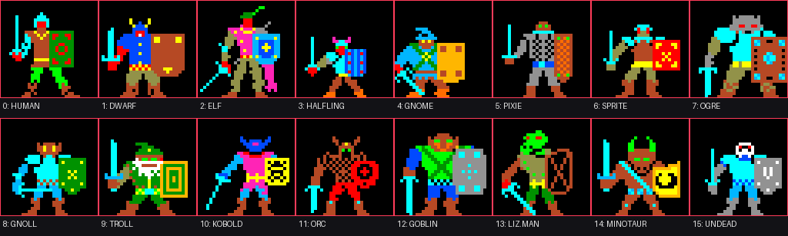
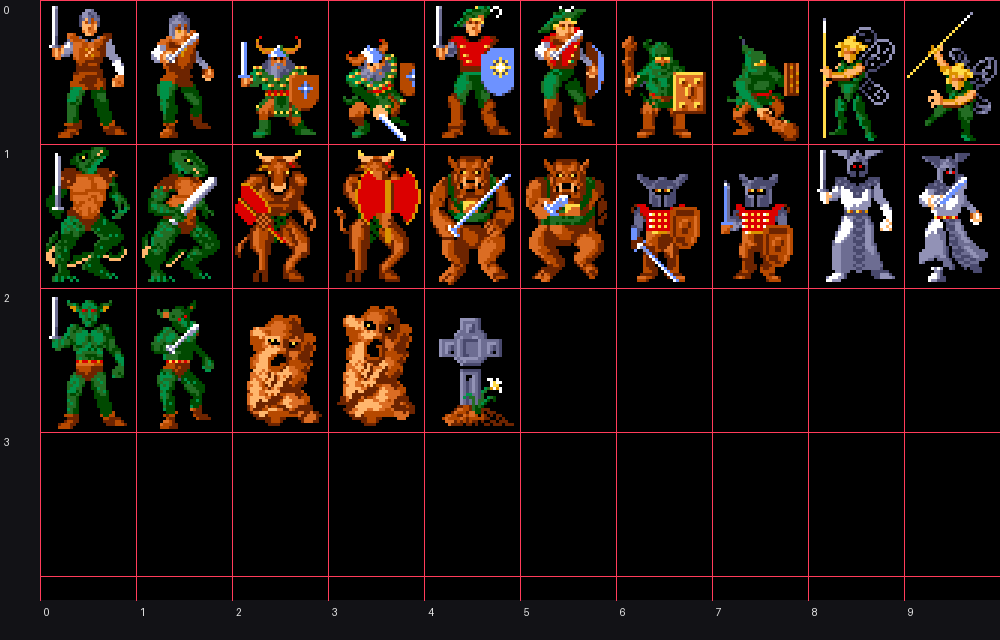

# Female Character Sprite Brief

A handoff spec for commissioning (human artist or image-generation tool)
female counterparts to Phantasie's playable-race sprites. This is a content
brief, not a reverse-engineering doc — nothing here describes the original
game's actual data, only the target format a new asset needs to match to
slot into the existing sprite-bank pipeline described in
[`graphics-formats.md`](graphics-formats.md) §7 and
[`data-tables.md`](data-tables.md) §1.4.

Both reference sheets below are original renders, decoded directly from this
project's own game data files by a clean-room decoder (see
[`implementation-plan.md`](implementation-plan.md)) — not reproductions of
any third-party artwork.

## 1. What to design

The primary target is **Phantasie I's 16-race party roster** — the
fully-confirmed set, one character per playable race, each in two poses
(idle/"normal" and "attacking"). This is the roster actually shown at
character creation.

*(Colors above use a confirmed placeholder palette pending recovery of the
game's real screen-specific palette — see `graphics-formats.md` §9 — so
treat this as a **silhouette, proportion, and pose reference**, not a final
color reference. Weapon/shield choice and general color family per race
should be treated as correct.)*

Phantasie III has a structurally similar roster (18 races — the same 16 plus
two more, most likely "Elemental" per `data-tables.md` §4) sharing a sprite
bank with some monster sprites, at a larger 32×48 canvas:

The exact race-to-cell mapping for Phantasie III isn't confirmed yet (open
question, `data-tables.md` §8), so **treat this second sheet as style
reference only** — proportions, linework, and the two-pose convention — not
as a per-race roster to fill in yet. Start with the Phantasie I set below;
the Phantasie III set can follow once its own roster is confirmed.

## 2. Technical specification

| | Phantasie I (`party1.pat`/`party2.pat`) | Phantasie III (`heros.cmp` bank 0) |
|---|---|---|
| Canvas per character | 32 × 32 px | 32 × 48 px |
| Color depth | 4bpp, 16-color indexed | 4bpp, 16-color indexed |
| Palette | One shared 16-color palette across all races (hex table below) | Embedded per-file ST palette (hex table below, `heros.cmp`'s own) |
| Poses | 2 — "normal" (`party1.pat`) and "attacking" (`party2.pat`), same race at the same file offset in each | 2 — normal/attacking as horizontally-adjacent grid cells |
| Roster size | 16 confirmed races | 18 races (roster not yet confirmed) |
| Background | Palette index 0 (black), no alpha channel | Same |

### Palette — Phantasie I (confirmed, `data-tables.md` §1.3)

| Idx | Hex | | Idx | Hex | | Idx | Hex | | Idx | Hex |
|---|---|---|---|---|---|---|---|---|---|---|
| 0 | `#000000` | | 4 | `#FFB600` | | 8 | `#929249` | | 12 | *(odd nibble, unresolved)* |
| 1 | `#B64924` | | 5 | `#FFFF00` | | 9 | `#00FFFF` | | 13 | `#929292` |
| 2 | `#FF0000` | | 6 | `#00FF00` | | 10 | `#00B6FF` | | 14 | `#FF24B6` |
| 3 | `#FF6D00` | | 7 | `#009200` | | 11 | `#0049FF` | | 15 | `#FFFFFF` |

### Palette — Phantasie III `heros.cmp` (confirmed, decoded directly from the file)

| Idx | Hex | | Idx | Hex | | Idx | Hex | | Idx | Hex |
|---|---|---|---|---|---|---|---|---|---|---|
| 0 | `#000000` | | 4 | `#9292B6` | | 8 | `#009249` | | 12 | `#DB0000` |
| 1 | `#FFB66D` | | 5 | `#6D6D92` | | 9 | `#246D24` | | 13 | `#DB9200` |
| 2 | `#B64900` | | 6 | `#49496D` | | 10 | `#004900` | | 14 | `#FFDB49` |
| 3 | `#DB6D24` | | 7 | `#6D2400` | | 11 | `#6D92FF` | | 15 | `#FFFFFF` |

You don't need to draw pre-quantized to these palettes — full-color art is
fine. I'll handle 16-color quantization and packing into the on-disk sprite
format on my end (see §5). It's useful for the artist/generator to see the
target palette though, since the original game's visual identity comes
largely from these specific hue families (rust/orange, olive/forest green,
slate blue-grey) rather than saturated modern game-art colors.

## 3. Style direction

Derived directly from the reference sheets above — match, don't reinvent:

- **Proportions:** chunky, roughly 4–4.5 "heads" tall, wide shoulders/torso
  relative to legs — mid-1980s 16-color RPG sprite proportions, not modern
  chibi or realistic anatomy.
- **Pose:** front/three-quarter facing, weapon held ready, weight centered
  — a character-select portrait pose, not an action shot.
- **Line and fill:** bold dark outlines, mostly flat color fills with at
  most 2–3 value steps per surface (no smooth gradients/anti-aliasing — it
  will be quantized away regardless).
- **Per-race identity carries over unchanged:** each race's weapon type,
  shield shape/color, and skin/fur/scale color family (e.g. Orc's green
  skin + red round shield, Minotaur's horns + orange shield, Undead's pale
  wraith coloring) should stay recognizable — the design task is "the same
  16 characters, read as female," not new race concepts.

**Tone: match the source material's all-ages, practical-adventurer
presentation.** These are 1980s SSI box-art-style character portraits —
functional armor sized like the male roster's (not reduced coverage or
exaggerated proportions), with gender read carried through face, hairstyle,
and silhouette (e.g. a visible braid or ponytail under a helm, a narrower
waist/jaw) rather than through costume skimpiness. If you're prompting an
image generator, it's worth being explicit about this — "practical armor,
same coverage as the reference" — since the default lean for "female fantasy
warrior" in most models skews toward cheesecake armor that wouldn't fit this
game's actual visual register at all.

## 4. Roster reference (Phantasie I, in sheet order)

| # | Race | Observed cues from the reference sheet |
|---|------|--------------------------------------------|
| 0 | Human | Sword + round shield, green tunic — the baseline silhouette |
| 1 | Dwarf | Sword + large shield, stocky/wide proportions, horned helm |
| 2 | Elf | Sword + heraldic diamond shield, tall and slender |
| 3 | Halfling | Small-scale sword, short proportions, striped tunic |
| 4 | Gnome | Sword + diamond shield, short, robed |
| 5 | Pixie | Slight build, minimal visible armor, "sparkle"/effect-heavy |
| 6 | Sprite | Slight build, teal tones, shield + weapon |
| 7 | Ogre | Oversized/hulking, large mace or hammer, big shield |
| 8 | Gnoll | Canine-humanoid features, light effects visible |
| 9 | Troll | Tall, lanky, green/orange checkered shield |
| 10 | Kobold | Small reptilian/goblinoid, sword + shield |
| 11 | Orc | Green skin, spear or sword, red round shield |
| 12 | Goblin | Small, green-skinned, sword + tunic |
| 13 | Liz.Man | Yellow-green scaled skin, reptilian facial features |
| 14 | Minotaur | Bull head, horns, muscular, sword + shield |
| 15 | Undead | Pale, skeletal or wraith-like, downward blade pose |

## 5. Deliverable format

Either works — I'll adapt on my end:

- **Preferred:** one image per race per pose (32 files total), clearly
  named (`elf-normal.png`, `elf-attack.png`, ...), any resolution — I'll
  downscale/quantize to the exact 32×32 target.
- **Also fine:** a single contact sheet matching the reference layout (8
  columns × 2 rows per pose, two sheets) if that's easier for whatever tool
  you're using.

Once I have source art, my side of the pipeline is: quantize to the
16-color palette (reusing the existing palette above for drop-in
compatibility, unless you'd rather this roster get its own bank), crop/align
to the grid, and pack into the same on-disk layout `party1.pat`/`party2.pat`
already use — so it loads through the same decoder as the original sprites,
no special-casing needed at runtime.
